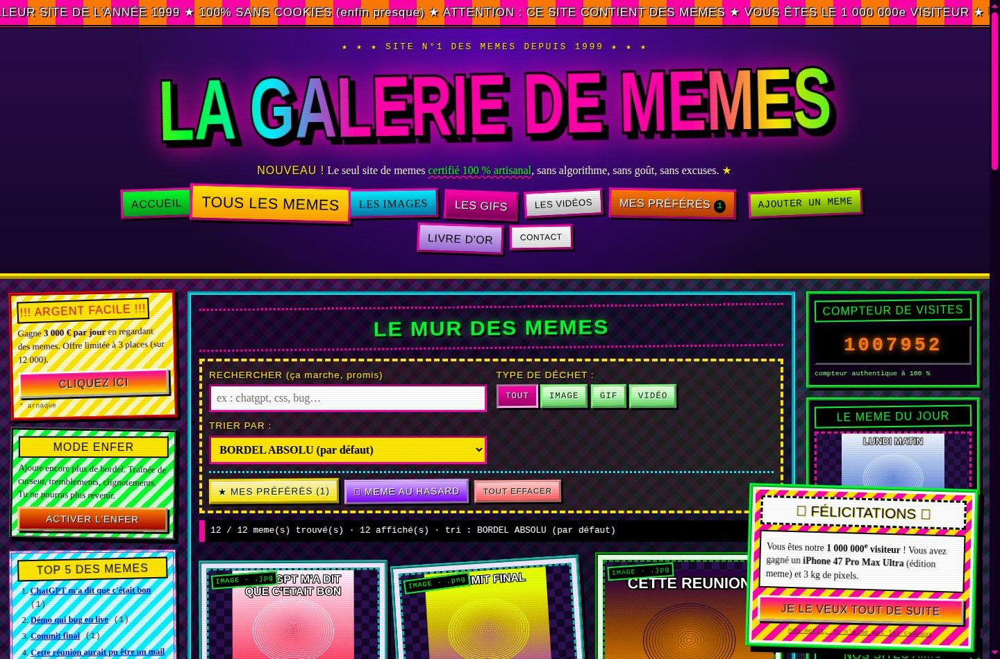

# 🦄 LA GALERIE DE MEMES

> Le seul site de memes certifié 100 % artisanal, sans algorithme, sans goût, sans excuses.



Une galerie pour **stocker et regarder ses memes** (images, GIF, vidéos) — avec une interface
volontairement **horrible** : néons, Comic Sans, bandeau qui défile, pubs clignotantes, cartes
de travers, popup des années 2000. Tout est laid **exprès**, mais tout **fonctionne** :
recherche, filtres, favoris, tri, visionneuse clavier, liens directs, upload, livre d'or.

Le contenu n'est pas une blague : déposez vos fichiers, ils sont indexés automatiquement.

---

## Démarrage

```bash
git clone https://github.com/swanlepeltier/meme-gallery.git
cd meme-gallery
node server.mjs        # ou : npm start
# → http://127.0.0.1:4321
```

Aucune dépendance à installer. Node 18+ suffit (testé sur Node 26). Le serveur local :

- sert le site statique ;
- régénère `media.json` à la demande (`/api/media`) ;
- accepte les uploads du formulaire (`POST /api/upload`).

Pour un simple serveur statique (sans upload) :

```bash
python3 -m http.server 4321
```

> Si vous ouvrez `index.html` en `file://`, le navigateur bloquera `fetch()` :
> passez par un serveur, même minimaliste.

---

## Structure

```
meme-gallery/
├── index.html              # la page (une seule, comme en 1999)
├── css/chaos.css           # 1 100 lignes de mauvais goût assumé
├── js/app.js               # chargement, filtres, tri, favoris, visionneuse, upload
├── js/chaos.js             # popup, compteur, mode enfer, livre d'or, newsletter
├── tools/build-manifest.mjs# scanne media/ → media.json (zéro dépendance)
├── server.mjs              # serveur local + API d'upload
├── media.json              # index généré (ne pas éditer à la main)
├── media/
│   ├── images/             # .jpg .png .gif .webp .avif .bmp
│   ├── videos/             # .mp4 .webm .ogv .mov .m4v .mkv
│   └── memes.json          # titres + tags personnalisés (optionnel)
└── docs/apercu.jpg         # capture d'écran
```

### Où mettre mes memes ?

- **Images et GIF** → `media/images/`
- **Vidéos** → `media/videos/`
- Puis :

```bash
npm run index
```

C'est tout. Les noms de fichiers deviennent les titres (`quand-le-code-marche.jpg` →
« quand le code marche »), et la galerie se met à jour au prochain chargement.

### Titres et tags personnalisés

Créez/complétez `media/memes.json` :

```json
{
  "quand-le-code-marche.jpg": {
    "title": "Quand le code marche du premier coup",
    "tags": ["dev", "suspect"]
  },
  "demo-qui-bug.mp4": {
    "title": "Démo qui bug en live",
    "tags": ["demo", "honte"]
  }
}
```

Les tags deviennent des boutons cliquables dans les cartes (ils remplissent la recherche).

### Vignettes de vidéos (optionnel)

Déposez une image `mon-meme.poster.jpg` à côté de `mon-meme.mp4` : elle sert de vignette.
Sans poster, la carte affiche un rectangle avec une icône 🎬 (et la vidéo se lance dans la visionneuse).

Même principe pour les GIF : `mon-gif.poster.jpg` évite de charger l'animation dans la grille.
Sans poster, le GIF s'anime directement dans la carte.

### Upload depuis le navigateur

Section « AJOUTER UN MEME » en bas de page. Ça écrit le fichier dans `media/images/` ou
`media/videos/`, régénère `media.json` et ouvre le meme tout juste ajouté.

Limites : 200 Mo, extensions image/vidéo connues, noms de fichiers nettoyés.
Sur un hébergement statique (GitHub Pages), l'API n'existe pas : utilisez la méthode
dossier + `npm run index`.

---

## Ce qui marche vraiment

| Fonction | Détail |
|---|---|
| Recherche | Titre, nom de fichier, tags, insensible aux accents |
| Filtres | Tout / images / GIF / vidéos / favoris |
| Tri | Bordel absolu (pseudo-aléatoire stable), récent, A→Z, Z→A, plus vus, plus lourds |
| Favoris | `localStorage`, compteur dans la navigation |
| Vues | Compteur local par meme, utilisé par le tri et le top 5 |
| Visionneuse | `←` `→` `Échap`, clic sur le fond pour fermer, clic sur le meme pour agrandir |
| Liens directs | `#meme=identifiant`, partageables, ouvrent la visionneuse au chargement |
| Téléchargement | Bouton dans la visionneuse |
| Copie de lien | Clipboard API + repli `execCommand` |
| Pagination | « Afficher plus de bordel » par tranches de 12 |
| Livre d'or | Stocké dans le navigateur, 50 messages max |
| Newsletter | Validée puis… jamais envoyée (c'est une blague) |
| Responsive | 2 colonnes sur mobile, colonnes latérales empilées |
| Accessibilité | Vrais boutons, `aria-*`, focus visible, `prefers-reduced-motion` respecté |

## Ce qui est cassé exprès

- Titre WordArt en SVG, contour noir, dégradé animé.
- Bandeau défilant, compteur de visites faux, badges « Netscape Now ».
- Cartes penchées, hauteurs variables, bordures qui changent de couleur, pubs intercalées dans la grille.
- Popup « vous avez gagné un iPhone 47 » après quelques secondes (une fois par session).
- Bouton « MODE ENFER » : traînée d'emojis, tremblements, clignotements, pluie d'emojis.
- Faux encarts publicitaires, fausses mentions légales, faux webring.
- Textes qui hurlent en majuscules, Comic Sans, Impact, Papyrus.

> **Ne « corrigez » pas le CSS.** Il est moche volontairement. Si vous voulez un site propre,
> ce n'est pas le bon dépôt.

---

## Déploiement (GitHub Pages)

Le site est 100 % statique : `index.html`, `css/`, `js/`, `media/`, `media.json`.

1. Poussez sur `main`.
2. Dépôt → **Settings** → **Pages** → Source : *Deploy from a branch*, branche `main`, dossier `/ (root)`.
3. Le site sera servi sur `https://swanlepeltier.github.io/meme-gallery/`.

Les chemins sont relatifs, donc ça fonctionne dans un sous-dossier. Seul l'upload est
indisponible en ligne (pas de serveur) : ajoutez vos memes en local puis poussez.

---

## Personnalisation rapide

| Envie | Où |
|---|---|
| Changer les couleurs | Variables `:root` en haut de `css/chaos.css` |
| Changer les textes de pubs | `js/chaos.js` (`CITATIONS`) et `index.html` |
| Changer les palettes des cartes | `PALETTES` dans `js/app.js` |
| Changer le nombre de cartes par page | `PAGE_SIZE` dans `js/app.js` |
| Changer la fréquence du popup | `setupPopup()` dans `js/chaos.js` |
| Ajouter des emojis | `EMOJIS` dans `js/chaos.js` |

---

## Notes techniques

- `media.json` contient pour chaque fichier : `id`, `type`, `gif`, `ext`, `src`, `bytes`,
  `mtime`, `width`, `height`, `duration`, `poster`, `title`, `tags`, `mime`, `playable`.
- Les dimensions sont lues **dans les en-têtes** des fichiers (PNG/JPEG/GIF/WebP) sans
  dépendance ; les vidéos passent par `ffprobe` s'il est installé, sinon par l'atome `tkhd`.
- Le format est détecté par signature binaire, pas par extension : un `.webp` qui contient
  du JPEG est servi correctement.
- Pas de build, pas de framework, pas de `node_modules`.

## Licence

Faites-en ce que vous voulez. Les memes d'exemple sont générés pour le dépôt.
